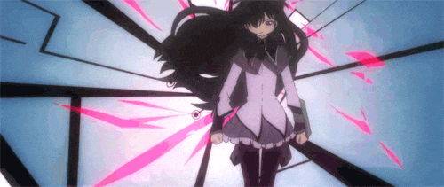

### Hi there! 👋

I'm a Computer Science student at **Colorado State University** concentrating in **Networks and Security** (with a minor in Political Scienc). I love Cybersecurity, Software Engineering, and Politics, and my favorite thing in the world is the intersection of all three. 

Of course, I know my way around a computer a bit with this kind of knowledge:
- **Languages:** Python, Java, SQL, R, HTML, Bash, PowerShell
- **Certifications:** CompTIA Security+, Cisco Certified Support Technician (CCST)

 

---

I have some previous education too! Check it out! 

### 🎓 Previous Education
* **Associate of Applied Science (AAS) in Cybersecurity** — Pikes Peak State College
* Certificates in **Cybersecurity**, **Computer Networking**, and **Network+** (not the official Network+). 

---

Here's some of my old projects. I may come back to some while others are practically complete.

### 💻 Previous Projects
* **Self-Hosted Homelab:** Configured and maintain a personal server environment hosting Nextcloud and a custom Minecraft server for my friends.
* **AmberDash:** A campaign finance auditor web application to track and analyze political contributions.
* **Terminal Blackjack:** Developed a command-line Blackjack game in Java featuring full game-state logic.

---

Here's my working on! As time goes on things come and go from here.

### 🔭 Currently Working On
* **May's Anchorbox:** Developing a custom cybersecurity utility toolbox.

---

And of course, I do other things too. Here's some of them!

### ✨ Special Interests 
* **In Tech and Policy:** Learning all I can about cyberwarfare and cyberattacks, reviewing election data and analysis and creating my own new congressional districts.
* **Gaming & Media:** Competitive Pokemon (both VGC and Smogon, as well as the TCG), fighting games like Super Smash Bros. Melee, Ultimate, and Guilty Gear Strive, Rougelikes like Slay the Spire, Balatro, Haste, and Risk of Rain 2, and anime (especially Madoka Magica and Bocchi the Rock!).
* **Sports:** The New York Mets, The New York Rangers, The New York Giants in professional sports, and my home school of CSU (go rams!), as well as the Virginia Tech Hokies and Michigan Wolverines1

